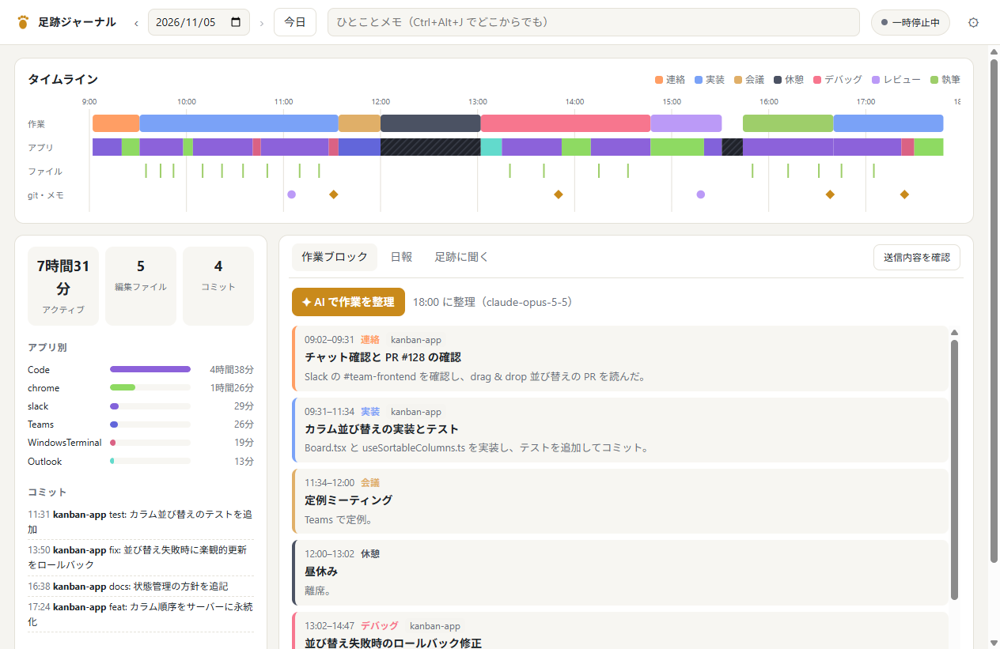
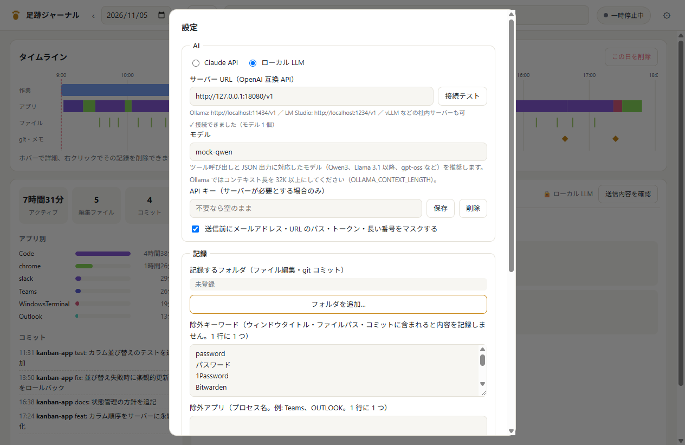

# 足跡ジャーナル (Ashiato)

PC での作業を**ローカルで自動記録**し、AI が「作業ブロックへの整理」「日報の下書き」「過去の作業への質問応答」をしてくれる Windows 向けデスクトップアプリです（Electron）。AI は **Claude API** と **ローカル LLM**（Ollama / LM Studio / vLLM などの OpenAI 互換サーバー）を切り替えて使えます。



## ダウンロード

[Releases](../../releases) から取得してください。

- `Ashiato-Setup-x.y.z.exe` — インストーラー
- `Ashiato-x.y.z-portable.exe` — インストール不要版

> まだコード署名をしていないため、初回起動時に Windows SmartScreen の警告が出ます。「詳細情報」→「実行」で起動できます。`SHA256SUMS.txt` でファイルの改ざんがないか確認できます。

## できること

| 機能 | 内容 |
|---|---|
| 自動記録 | アクティブウィンドウ（アプリ名・タイトル）、離席（無操作・画面ロック）、登録フォルダ内のファイル編集、自分の git コミット |
| クイックメモ | `Ctrl+Alt+J` でどこからでも一言メモ。日報の重要な手がかりになります |
| タイムライン | 1 日を横軸に、作業ブロック / アプリ / ファイル / コミット・メモの 4 レーンで表示。右クリックで個別の記録を削除 |
| ✦ AI で作業を整理 | 数分おきのアプリ往復を、意味のある「作業ブロック」（実装・レビュー・会議…）にまとめます |
| ✦ 日報を生成 | テンプレートに沿った日報の下書きをストリーミングで生成。思考の要約も表示。生成後に編集でき、Markdown / プレーンテキストでコピー |
| ✦ 足跡に聞く | 「昨日の午後は何してた？」「今週やったことをまとめて」に、AI が記録を検索して答えます |
| 一時停止 | 30 分 / 1 時間 / 今日はもう記録しない / 再開するまで。停止中は画面の観測そのものを止めます |

## AI の選び方

| | Claude API | ローカル LLM |
|---|---|---|
| 向いている人 | 個人、手軽に高品質な結果がほしい | 会社など、記録を社外に出したくない |
| 送信先 | Anthropic のクラウド | この PC または社内サーバー |
| 必要なもの | API キー | Ollama / LM Studio / vLLM などと、ツール呼び出し対応モデル |

### Claude API

- 既定は **Claude Opus 5.5**（設定で Sonnet 5.5 / Haiku 5.5 に変更可）
- 作業ブロックは**構造化出力**（Zod スキーマ）で型付き JSON として受け取ります
- 質問応答は **Tool Runner + ストリーミング**で、`list_days` / `get_day` / `search_events` を AI が自律的に使います
- **Adaptive thinking** の思考の要約を表示し、**effort** を用途別に調整しています
- **サーバーサイドフォールバック**（`fallbacks: "default"`）により、安全性判定で辞退されたときは自動で適切なモデルに切り替わります

### ローカル LLM



1. [Ollama](https://ollama.com/) などを起動し、モデルを用意します（例: `ollama pull qwen3:14b`）
2. ⚙ →「AI」で「ローカル LLM」を選び、サーバー URL を入力して「接続テスト」を押します
   - Ollama: `http://localhost:11434/v1`
   - LM Studio: `http://localhost:1234/v1`
3. 表示されたモデルを選んで保存します

ツール呼び出しと JSON 出力に対応したモデル（Qwen3、Llama 3.1 以降、gpt-oss など）を推奨します。Ollama は既定のコンテキスト長が短いので、`OLLAMA_CONTEXT_LENGTH=32768` 以上に設定してください。

モデルの能力差を吸収するため、次のように段階的にフォールバックします。

- JSON Schema 指定 → JSON モード → スキーマエラーを伝えて再生成
- ツール呼び出し非対応のモデルでは、直近の記録をプロンプトに入れて回答
- Qwen3 / DeepSeek-R1 などの `<think>` タグや `reasoning_content` は、思考の要約欄に表示

社内サーバーなど、この PC 以外へ暗号化されていない `http://` で送る場合は、接続テスト時に警告します。

## プライバシーとセキュリティ

- **記録データはこの PC にだけ保存**されます（`%LOCALAPPDATA%\Ashiato\journal\` の JSONL）。移動プロファイルでサーバーにコピーされないよう、Roaming ではなく Local に置いています
- **初回は同意画面**で、何が記録され、どこへ送られるかを確認してから記録を始めます
- **AI に送るのは AI 機能を使ったときだけ**です
  - 作業整理と日報では、その日の要約済みタイムラインを送ります
  - 「足跡に聞く」では、AI が必要に応じて他の日の記録も検索して送ります。参照した内容はチップで表示されます
  - 「送信内容を確認」で、送信先とデータをそのまま確認できます
- **送らない・残さない工夫**
  - 除外キーワード（ウィンドウタイトル・ファイルパス・コミットに適用）と除外アプリ
  - 送信前のマスク（メールアドレス・URL のパス・API トークン・10 桁以上の番号）
  - 日ごと・記録ごとの削除と、保存期間による自動削除
- **キーの保存**: API キーは OS の暗号化ストレージ（Electron `safeStorage` / Windows DPAPI）で保存します。なお、同じ Windows ユーザーで動くプログラムからは復号できる仕組みです
- **プロンプトインジェクション対策**: 記録中の `<` `>` は全角に置き換え、タイトル等の文章には従わないようモデルに指示しています
- **Electron の堅牢化**
  - contextIsolation・sandbox を有効化し、外部ページへの遷移と新規ウィンドウを禁止しています
  - IPC は送信元フレームの検証と、zod による入力検証を通しています
  - 権限リクエストは既定で拒否します
  - AI 出力のリンクは、確認ダイアログを経てブラウザで開きます
  - Electron Fuses（RunAsNode・NODE_OPTIONS・--inspect の無効化、asar 整合性検証）を有効にしています
- **ウィンドウ情報の取得**: Windows 標準の PowerShell（絶対パス指定）に、スクリプトを標準入力で渡します。`-ExecutionPolicy Bypass` や `-EncodedCommand` は使っていません。社内ポリシー（制約付き言語モード等）で取得できない場合は、画面上部に警告が出ます

## 開発

```bash
npm install
npm start
```

チェックとビルド:

```bash
npm run typecheck   # 型チェック
npm test            # ユニットテスト（ローカル LLM はモックサーバーで検証）
npm run dist -- --win nsis portable   # release/ にインストーラーとポータブル版
```

### デモデータで試す

実データを使わずに画面を見たいときは、架空の 1 日を生成します。

```bash
node scripts/seed-demo.mjs .demo-profile 2026-11-05
```

```bash
ASHIATO_USER_DATA=.demo-profile npx electron .
```

開発時のみ有効です。パッケージ版では無視されます。

### リリース

`package.json` の `version` を上げてコミットし、同じ番号のタグを push すると、GitHub Actions がビルドして Release を作成します。

```bash
git tag v0.0.2
```

```bash
git push origin v0.0.2
```

## 仕組み

```
src/
  main/
    activeWindow.ts  前面ウィンドウの取得（Windows: 常駐 PowerShell + Win32 API）
    recorder.ts      ウィンドウ区間・離席・ファイル監視・git ポーリング、記録の健全性チェック
    store.ts         日ごとの JSONL と AI 結果、設定の検証、暗号化キー、削除・保存期間
    compress.ts      生イベントを AI が読みやすい時系列テキストに圧縮
    ai/
      index.ts       AI 機能の窓口（送信先の選択、ツール定義、中止）
      claude.ts      Claude API プロバイダー
      local.ts       OpenAI 互換ローカル LLM プロバイダー
      prompts.ts     システムプロンプト・スキーマ・共通型
    index.ts         ウィンドウ、トレイ、ショートカット、IPC、セキュリティ設定
  preload.ts         contextIsolation 下で renderer に API を公開
  renderer/          UI（依存は marked + DOMPurify のみ）
  shared/            型定義、マスク処理
test/                node:test によるテスト
```

## 動作環境

Windows 10 / 11。macOS と Linux はコード上の下地のみで、現時点では配布していません。

## ライセンス

MIT
